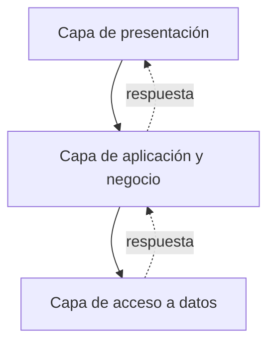

# VoteSecure

**Elecciones académicas ordenadas, confidenciales y verificables**

---

VoteSecure es una aplicación para organizar y desarrollar procesos electorales académicos de manera ordenada, confidencial y verificable. Permite gestionar elecciones vinculadas a cursos y secciones, facilitar la participación de estudiantes habilitados y consultar sus resultados.

## Tabla de contenido

- [¿Qué permite hacer?](#qué-permite-hacer)
- [Arquitectura por capas](#arquitectura-por-capas)
- [Principios del proyecto](#principios-del-proyecto)
- [Integrantes](#integrantes)

---

## ¿Qué permite hacer?

- Gestionar elecciones y sus candidaturas dentro del contexto académico correspondiente.
- Organizar la participación de las personas habilitadas para cada elección.
- Registrar la participación de forma que se preserve la confidencialidad del voto.
- Consultar y difundir resultados agregados durante el proceso electoral, sin exponer la identidad de quienes votaron.
- Mantener un registro de los eventos relevantes para favorecer la trazabilidad del proceso.
- Realizar evaluaciones de delegados por parte de estudiantes y docentes, de acuerdo con el periodo y la sección correspondiente.

---

## Arquitectura por capas

La aplicación se organizará mediante una arquitectura por capas. Cada capa tendrá una responsabilidad definida y colaborará con las demás para atender las funciones del sistema.

> [!NOTE]
> Esta es la arquitectura prevista para el proyecto; su descripción no significa que todas sus partes ya estén implementadas.

### Capa de presentación

Es el punto de interacción con las personas usuarias. Recibe sus solicitudes y presenta las respuestas de la aplicación. También verifica, según corresponda, quién está usando el sistema y qué acciones puede realizar.

### Capa de aplicación y negocio

Coordina las actividades de VoteSecure y aplica las reglas que dan sentido a sus procesos. Aquí se organizan las funciones relacionadas con las cuentas y el acceso, la gestión electoral, las candidaturas, la votación, los resultados, la auditoría y la evaluación de delegados.

Esta capa protege reglas como la elegibilidad para participar, el voto único por elección y la relación entre cada elección y su curso o sección. También coordina procesos que deben conservar un resultado coherente, como el cierre de una elección y la publicación de sus resultados.

### Capa de acceso a datos

Permite consultar y conservar la información que necesita la aplicación. Su responsabilidad es mantener los datos relacionados con las cuentas, el contexto académico, las elecciones, las candidaturas, la participación, los resultados y los registros de auditoría.

### Cómo colaboran las capas

Cuando una persona realiza una acción, la capa de presentación recibe la solicitud; la capa de aplicación y negocio comprueba las reglas y coordina el proceso; y la capa de acceso a datos consulta o registra la información necesaria. Luego, la respuesta vuelve a la persona a través de la capa de presentación.

<b>Ver ejemplo: emisión de un voto y cierre de una elección</b>

 

Por ejemplo, al emitir un voto, el sistema comprueba que la elección esté habilitada y que la persona pueda participar. Después registra la participación respetando el voto único y la confidencialidad. Al finalizar una elección, coordina el cierre y la publicación de resultados, conservando la trazabilidad correspondiente.

---

## Principios del proyecto

| Principio | Descripción |
|---|---|
| **Confidencialidad** | Proteger la identidad de las personas votantes y mantenerla separada de la opción elegida. |
| **Participación válida** | Permitir votar únicamente a quienes estén habilitados y evitar más de un voto por persona en una misma elección. |
| **Integridad** | Conservar la coherencia de la información y de los resultados del proceso electoral. |
| **Trazabilidad** | Registrar los eventos relevantes para facilitar el seguimiento de las acciones realizadas. |
| **Organización académica** | Vincular los procesos electorales y las evaluaciones con sus cursos, secciones y periodos correspondientes. |

---

## Integrantes

Integrantes del grupo de desarrollo del proyecto VoteSecure:

| | Integrante | GitHub |
|:---:|---|---|
|  | **Johan Castillon Ruiz** | [Perfil](https://github.com/Johan409IA) |
|  | **Jhonatan Navarro Lopez** | [Perfil](https://github.com/JhonatanNav6) |
|  | **Tatiana Rojas Caldas** | [Perfil](https://github.com/Yeraldinn-R) |
|  | **Elton Vacas Neyra** | [Perfil](https://github.com/eltiton0-0) |
|  | **Dalia Pariachi Herrera** | [Perfil](https://github.com/tk27jp) |